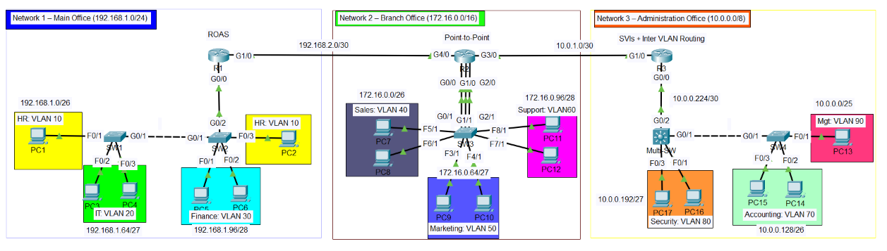

# Enterprise Network Project: 3 Routers, 3 Inter-VLAN Routing Methods, VLSM

A CCNA-level Cisco Packet Tracer project. It connects three offices, each using a different inter-VLAN routing method, with VLSM subnetting, VLANs, trunks and static routing.

## Contents

1. [Overview](#overview)
2. [Topology](#topology)
3. [VLANs](#vlans)
4. [Addressing plan (VLSM)](#addressing-plan-vlsm)
5. [Point-to-point links](#point-to-point-links)
6. [Configuration](#configuration)
7. [Verification](#verification)
8. [Skills demonstrated](#skills-demonstrated)
9. [Repository structure](#repository-structure)
10. [How to open and use this project](#how-to-open-and-use-this-project)
11. [Author](#author)

## Overview

| Network | Office | Router | Inter-VLAN method | Parent block |
|---|---|---|---|---|
| 1 | Main Office | R1 | Router-on-a-Stick (ROAS) | 192.168.1.0/24 |
| 2 | Branch Office | R2 | Point-to-point (one router interface per VLAN) | 172.16.0.0/24 used |
| 3 | Administration Office | R3 | Layer 3 switch with SVIs, routed link to the router | 10.0.0.0/24 used |

Each department has 2 PCs. The required host counts are future capacity, and the subnets are sized with VLSM to fit them.

Addressing rule used in every subnet:

- First usable IP: first PC
- Second usable IP: second PC
- Last usable IP: default gateway (router subinterface, router interface or SVI)

## Topology

```
Network 1 (ROAS)              Network 2 (Point-to-point)          Network 3 (SVIs)

PC1,PC2 -- SW1 --+                                                 PC13.. -- SW4 --+
PC3,PC4 --       |-- SW2 -- R1 ==== R2 ==== R3 -- Multilayer SW --------------+
PC5,PC6 -------- +             192.168.2.0/30  10.0.1.0/30  10.0.0.224/30
                                    |
                       3 links (G0/0, G1/0, G2/0)
                                    |
                                   SW3 -- PC7..PC12
```



The full Packet Tracer file is in [`topology/enterprise-network.pkt`](topology/enterprise-network.pkt).

## VLANs

| Network | VLAN | Name | Subnet |
|---|---|---|---|
| 1 | 10 | HR | 192.168.1.0/26 |
| 1 | 20 | IT | 192.168.1.64/27 |
| 1 | 30 | Finance | 192.168.1.96/28 |
| 2 | 40 | Sales | 172.16.0.0/26 |
| 2 | 50 | Marketing | 172.16.0.64/27 |
| 2 | 60 | Support | 172.16.0.96/28 |
| 3 | 70 | Accounting | 10.0.0.128/26 |
| 3 | 80 | Security | 10.0.0.192/27 |
| 3 | 90 | Management | 10.0.0.0/25 |

Native VLAN **999** is set on both ends of every switch trunk (Network 1 and Network 3). Only the VLANs the far switch needs are allowed on each trunk: SW1 to SW2 carries 10,20, SW2 to R1 carries 10,20,30, and Multilayer SW to SW4 carries 70,90.

## Addressing plan (VLSM)

Subnets are allocated largest first, so there is no wasted space or overlap.

### Network 1: Main Office (192.168.1.0/24)

| Department | VLAN | Hosts needed | Network | Mask | First usable | Last usable (gateway) | Broadcast | Usable hosts |
|---|---|---|---|---|---|---|---|---|
| HR | 10 | 40 | 192.168.1.0/26 | 255.255.255.192 | 192.168.1.1 | 192.168.1.62 | 192.168.1.63 | 62 |
| IT | 20 | 24 | 192.168.1.64/27 | 255.255.255.224 | 192.168.1.65 | 192.168.1.94 | 192.168.1.95 | 30 |
| Finance | 30 | 12 | 192.168.1.96/28 | 255.255.255.240 | 192.168.1.97 | 192.168.1.110 | 192.168.1.111 | 14 |

### Network 2: Branch Office (172.16.0.0/16 parent, 172.16.0.0/24 used)

| Department | VLAN | Hosts needed | Network | Mask | First usable | Last usable (gateway) | Broadcast | Usable hosts |
|---|---|---|---|---|---|---|---|---|
| Sales | 40 | 50 | 172.16.0.0/26 | 255.255.255.192 | 172.16.0.1 | 172.16.0.62 | 172.16.0.63 | 62 |
| Marketing | 50 | 25 | 172.16.0.64/27 | 255.255.255.224 | 172.16.0.65 | 172.16.0.94 | 172.16.0.95 | 30 |
| Support | 60 | 10 | 172.16.0.96/28 | 255.255.255.240 | 172.16.0.97 | 172.16.0.110 | 172.16.0.111 | 14 |

### Network 3: Administration Office (10.0.0.0/8 parent, 10.0.0.0/24 used)

| Department | VLAN | Hosts needed | Network | Mask | First usable | Last usable (gateway) | Broadcast | Usable hosts |
|---|---|---|---|---|---|---|---|---|
| Management | 90 | 100 | 10.0.0.0/25 | 255.255.255.128 | 10.0.0.1 | 10.0.0.126 | 10.0.0.127 | 126 |
| Accounting | 70 | 45 | 10.0.0.128/26 | 255.255.255.192 | 10.0.0.129 | 10.0.0.190 | 10.0.0.191 | 62 |
| Security | 80 | 20 | 10.0.0.192/27 | 255.255.255.224 | 10.0.0.193 | 10.0.0.222 | 10.0.0.223 | 30 |

### Subnet sizing

The smallest block that fits each requirement is used: 2^n - 2 >= hosts.

- 40 and 50 hosts: /26 (62 usable)
- 24, 25 and 20 hosts: /27 (30 usable)
- 12 and 10 hosts: /28 (14 usable)
- 100 hosts: /25 (126 usable)
- 45 hosts: /26 (62 usable)

### PC addresses

| PC | VLAN | IP address | Mask | Gateway |
|---|---|---|---|---|
| PC1 | 10 | 192.168.1.1 | 255.255.255.192 | 192.168.1.62 |
| PC2 | 10 | 192.168.1.2 | 255.255.255.192 | 192.168.1.62 |
| PC3 | 20 | 192.168.1.65 | 255.255.255.224 | 192.168.1.94 |
| PC4 | 20 | 192.168.1.66 | 255.255.255.224 | 192.168.1.94 |
| PC5 | 30 | 192.168.1.97 | 255.255.255.240 | 192.168.1.110 |
| PC6 | 30 | 192.168.1.98 | 255.255.255.240 | 192.168.1.110 |
| PC7 | 40 | 172.16.0.1 | 255.255.255.192 | 172.16.0.62 |
| PC8 | 40 | 172.16.0.2 | 255.255.255.192 | 172.16.0.62 |
| PC9 | 50 | 172.16.0.65 | 255.255.255.224 | 172.16.0.94 |
| PC10 | 50 | 172.16.0.66 | 255.255.255.224 | 172.16.0.94 |
| PC11 | 60 | 172.16.0.97 | 255.255.255.240 | 172.16.0.110 |
| PC12 | 60 | 172.16.0.98 | 255.255.255.240 | 172.16.0.110 |
| PC13 | 90 | 10.0.0.1 | 255.255.255.128 | 10.0.0.126 |
| PC14 | 70 | 10.0.0.129 | 255.255.255.192 | 10.0.0.190 |
| PC15 | 70 | 10.0.0.130 | 255.255.255.192 | 10.0.0.190 |
| PC16 | 80 | 10.0.0.193 | 255.255.255.224 | 10.0.0.222 |
| PC17 | 80 | 10.0.0.194 | 255.255.255.224 | 10.0.0.222 |

## Point-to-point links

| Link | Subnet | Side A | Side B |
|---|---|---|---|
| R1 G1/0 to R2 G4/0 | 192.168.2.0/30 | R1 = 192.168.2.1 | R2 = 192.168.2.2 |
| R2 G3/0 to R3 G1/0 | 10.0.1.0/30 | R2 = 10.0.1.1 | R3 = 10.0.1.2 |
| R3 G0/0 to Multilayer SW G0/2 | 10.0.0.224/30 | R3 = 10.0.0.226 | Multilayer SW = 10.0.0.225 |

## Configuration

### Network 1: Router-on-a-Stick

**R1**

```
interface g0/0
 no shutdown
interface g0/0.10
 encapsulation dot1Q 10
 ip address 192.168.1.62 255.255.255.192
interface g0/0.20
 encapsulation dot1Q 20
 ip address 192.168.1.94 255.255.255.224
interface g0/0.30
 encapsulation dot1Q 30
 ip address 192.168.1.110 255.255.255.240
interface g1/0
 ip address 192.168.2.1 255.255.255.252
 no shutdown
ip route 172.16.0.0 255.255.255.192 192.168.2.2
ip route 172.16.0.64 255.255.255.224 192.168.2.2
ip route 172.16.0.96 255.255.255.240 192.168.2.2
ip route 10.0.0.0 255.255.255.128 192.168.2.2
ip route 10.0.0.128 255.255.255.192 192.168.2.2
ip route 10.0.0.192 255.255.255.224 192.168.2.2
```

**SW1**

```
vlan 10
 name HR
vlan 20
 name IT
interface f0/1
 switchport mode access
 switchport access vlan 10
interface range f0/2 - 3
 switchport mode access
 switchport access vlan 20
interface g0/1
 switchport mode trunk
 switchport trunk native vlan 999
 switchport trunk allowed vlan 10,20
```

**SW2**

```
vlan 10
 name HR
vlan 20
 name IT
vlan 30
 name Finance
interface f0/3
 switchport mode access
 switchport access vlan 10
interface range f0/1 - 2
 switchport mode access
 switchport access vlan 30
! Trunk to SW1
interface g0/1
 switchport mode trunk
 switchport trunk native vlan 999
 switchport trunk allowed vlan 10,20
! Trunk to R1
interface g0/2
 switchport mode trunk
 switchport trunk native vlan 999
 switchport trunk allowed vlan 10,20,30
```

On older IOS, add `switchport trunk encapsulation dot1q` before `switchport mode trunk`.

### Network 2: Point-to-point routing

Three separate router interfaces connect to three access ports on SW3, one VLAN each. There are no subinterfaces and no trunks.

**R2**

```
interface g0/0
 ip address 172.16.0.62 255.255.255.192
 no shutdown
interface g1/0
 ip address 172.16.0.94 255.255.255.224
 no shutdown
interface g2/0
 ip address 172.16.0.110 255.255.255.240
 no shutdown
interface g4/0
 ip address 192.168.2.2 255.255.255.252
 no shutdown
interface g3/0
 ip address 10.0.1.1 255.255.255.252
 no shutdown
ip route 192.168.1.0 255.255.255.192 192.168.2.1
ip route 192.168.1.64 255.255.255.224 192.168.2.1
ip route 192.168.1.96 255.255.255.240 192.168.2.1
ip route 10.0.0.0 255.255.255.128 10.0.1.2
ip route 10.0.0.128 255.255.255.192 10.0.1.2
ip route 10.0.0.192 255.255.255.224 10.0.1.2
```

**SW3**

```
vlan 40
 name Sales
vlan 50
 name Marketing
vlan 60
 name Support
! Router-facing ports
interface g0/1
 switchport mode access
 switchport access vlan 40
interface g1/1
 switchport mode access
 switchport access vlan 50
interface g2/1
 switchport mode access
 switchport access vlan 60
! PC ports
interface range f5/1, f6/1
 switchport mode access
 switchport access vlan 40
interface range f3/1, f4/1
 switchport mode access
 switchport access vlan 50
interface range f7/1, f8/1
 switchport mode access
 switchport access vlan 60
```

### Network 3: SVIs on a Layer 3 switch, routed link to R3

**R3**

```
interface g0/0
 ip address 10.0.0.226 255.255.255.252
 no shutdown
interface g1/0
 ip address 10.0.1.2 255.255.255.252
 no shutdown
! Network 3 via the Layer 3 switch
ip route 10.0.0.0 255.255.255.128 10.0.0.225
ip route 10.0.0.128 255.255.255.192 10.0.0.225
ip route 10.0.0.192 255.255.255.224 10.0.0.225
! Networks 1 and 2 via R2
ip route 192.168.1.0 255.255.255.192 10.0.1.1
ip route 192.168.1.64 255.255.255.224 10.0.1.1
ip route 192.168.1.96 255.255.255.240 10.0.1.1
ip route 172.16.0.0 255.255.255.192 10.0.1.1
ip route 172.16.0.64 255.255.255.224 10.0.1.1
ip route 172.16.0.96 255.255.255.240 10.0.1.1
```

**Multilayer switch**

```
ip routing
vlan 70
 name Accounting
vlan 80
 name Security
vlan 90
 name Management

interface vlan 90
 ip address 10.0.0.126 255.255.255.128
 no shutdown
interface vlan 70
 ip address 10.0.0.190 255.255.255.192
 no shutdown
interface vlan 80
 ip address 10.0.0.222 255.255.255.224
 no shutdown

! Routed link to R3
interface g0/2
 no switchport
 ip address 10.0.0.225 255.255.255.252
 no shutdown

! Trunk to SW4
interface g0/1
 switchport trunk encapsulation dot1q
 switchport mode trunk
 switchport trunk native vlan 999
 switchport trunk allowed vlan 70,90

! Security PCs
interface range f0/1, f0/3
 switchport mode access
 switchport access vlan 80

ip route 0.0.0.0 0.0.0.0 10.0.0.226
```

**SW4**

```
vlan 70
 name Accounting
vlan 90
 name Management
interface g0/1
 switchport mode trunk
 switchport trunk native vlan 999
 switchport trunk allowed vlan 70,90
interface range f0/1, f0/4
 switchport mode access
 switchport access vlan 90
interface range f0/2 - 3
 switchport mode access
 switchport access vlan 70
```

VLAN 80 (Security) exists only on the Layer 3 switch, so it is not allowed on the trunk and is not created on SW4.

## Verification

Run these on each device.

| Command | Where | What to check |
|---|---|---|
| `show vlan brief` | All switches | Ports are in the right VLANs, names match |
| `show interfaces trunk` | SW1, SW2, Multilayer SW, SW4 | 802.1q, trunking, allowed VLANs, same native VLAN on both ends |
| `show ip interface brief` | All routers and the Layer 3 switch | Interfaces and SVIs are up/up |
| `show ip route` | All routers and the Layer 3 switch | Connected and static routes are present |

### Ping tests

1. PC to its own gateway
2. PC to PC in the same VLAN across switches
3. PC to PC in a different VLAN of the same network (inter-VLAN routing)
4. PC13 to PC1 and PC1 to PC13 (Network 3 and Network 1)
5. PC1 to PC7 (Network 1 and Network 2)
6. PC13 to PC7 (Network 3 and Network 2)

### Results

All ping tests passed. The first ping in some tests times out while ARP resolves, and the remaining replies succeed. Screenshots of every command and test are in [`documentation/verification.md`](documentation/verification.md).

Notes:

- The R1, R2 and R3 routing tables were checked and the static routes point to the correct next hops.
- The routed link on R3 uses 10.0.0.226 and the Layer 3 switch uses 10.0.0.225, so the next hop in R3's routes to Network 3 is 10.0.0.225, and the switch's default route points to 10.0.0.226.
- Native VLAN 999 matches on both ends of every trunk.

## Skills demonstrated

- VLSM subnetting
- VLAN creation and access/trunk port configuration
- 802.1Q trunking with an allowed VLAN list and a custom native VLAN
- Three inter-VLAN routing methods: router-on-a-stick, point-to-point and Layer 3 switch SVIs
- Static routing between three routers
- Verification and troubleshooting with `show` commands and ping

## Repository structure

```
enterprise-network-project/
├── README.md                     Project overview, addressing plan, configs, verification
├── LICENSE                       MIT license
├── .gitignore
├── .gitattributes                Marks the .pkt file as binary
├── topology/
│   └── enterprise-network.pkt    Cisco Packet Tracer project file
├── images/
│   ├── topology.png              Packet Tracer topology screenshot
│   └── verification/             Screenshots of show commands and ping tests
├── configs/
│   ├── README.md
│   ├── routers/                  R1, R2, R3
│   └── switches/                 SW1, SW2, SW3, SW4, MLS (multilayer switch)
└── documentation/
    ├── topology-overview.md
    ├── vlan-table.md
    ├── addressing-table.md
    └── verification.md
```

## How to open and use this project

Requirements: [Cisco Packet Tracer](https://www.netacad.com/cisco-packet-tracer) (free with a Cisco Networking Academy account).

1. Clone or download this repository.
2. Open `topology/enterprise-network.pkt` in Packet Tracer.
3. To rebuild a device from scratch, open its CLI and paste the matching file from `configs/`. Check interface names against your own devices first.
4. Run the checks in [`documentation/verification.md`](documentation/verification.md).

## Author

Your Name | [LinkedIn](https://www.linkedin.com/in/your-profile) | [GitHub](https://github.com/your-username)

Licensed under the [MIT License](LICENSE).
