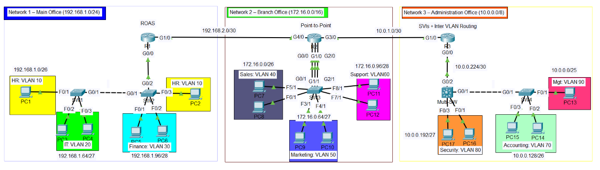

# Topology Overview

This project models three connected office networks using three routers and multiple switches. Each office demonstrates a different inter-VLAN routing approach.

## Office designs

| Network | Office | Main devices | Inter-VLAN routing approach |
|---|---|---|---|
| 1 | Main Office | R1, SW1, SW2 | Router-on-a-Stick |
| 2 | Branch Office | R2, SW3 | Separate physical router interface for each VLAN |
| 3 | Administration Office | R3, multilayer switch, SW4 | SVIs on a Layer 3 switch |

## WAN and routed connections

| Connection | Addressing |
|---|---|
| R1 ↔ R2 | `192.168.2.0/30` |
| R2 ↔ R3 | `10.0.1.0/30` |
| R3 ↔ Multilayer switch | `10.0.0.224/30` |

## Topology image

The Packet Tracer project file is [`../topology/enterprise-network.pkt`](../topology/enterprise-network.pkt).

For the detailed VLAN and IP assignments, see [vlan-table.md](vlan-table.md) and [addressing-table.md](addressing-table.md).
