# Verification and Testing Results

All checks below were run in Cisco Packet Tracer on the final topology. Commands are from the [main README](../README.md).

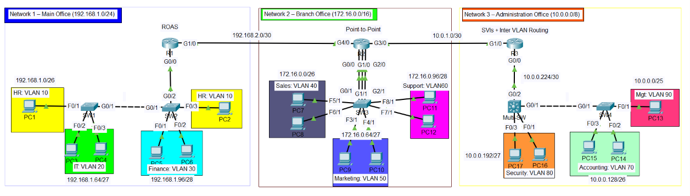

## 1. VLANs (`show vlan brief`)

**SW1**

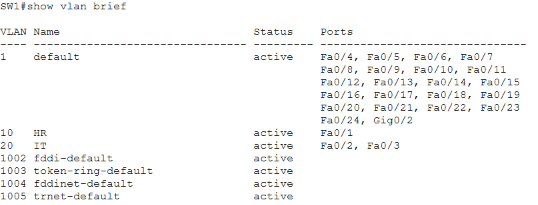

**SW2**

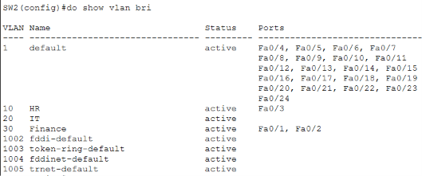

**SW3**

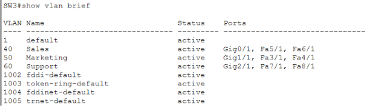

**Multilayer switch**

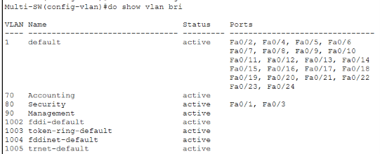

**SW4**

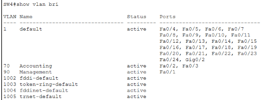

## 2. Trunks (`show interfaces trunk`)

Every trunk is 802.1q, trunking, native VLAN 999, with only the needed VLANs allowed.

**SW1 (allows 10,20)**

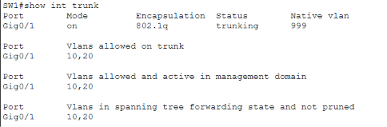

**SW2 (G0/1 allows 10,20; G0/2 allows 10,20,30)**

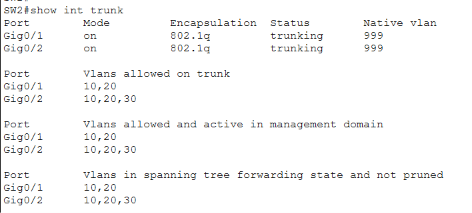

**Multilayer switch (allows 70,90)**

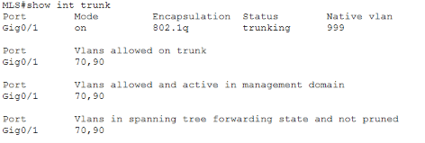

**SW4 (allows 70,90)**

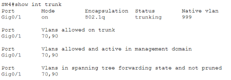

## 3. Interfaces (`show ip interface brief`)

**R1 (subinterfaces .10, .20, .30)**

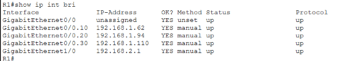

**R2**

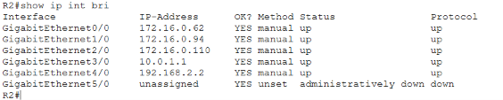

**R3**

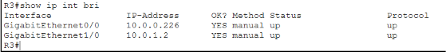

**Multilayer switch (SVIs 70, 80, 90)**

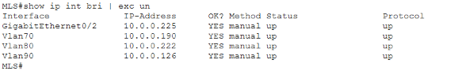

## 4. Routing tables (`show ip route`)

**R1**

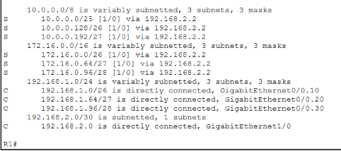

**R2**

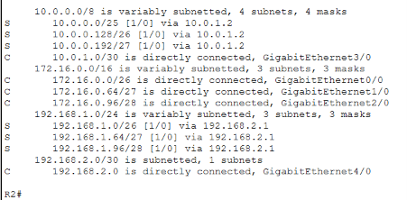

**R3**

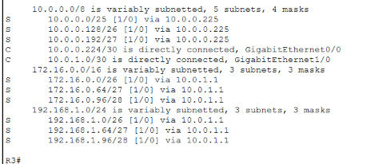

**Multilayer switch (default route via 10.0.0.226)**

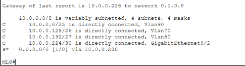

## 5. Ping tests

The first ping in some tests times out while ARP resolves. The remaining replies succeed.

| Test | Source | Destination | Expected | Actual | Status |
|---|---|---|---|---|---|
| Gateway reachability | PC1 | 192.168.1.62 (R1) | Successful ping | 4/4 replies | Pass |
| Same VLAN across switches | PC1 (SW1) | PC2 (SW2), 192.168.1.2 | Successful ping | 4/4 replies | Pass |
| Inter-VLAN, Network 1 (ROAS) | PC1 | PC3, 192.168.1.65 | Successful ping | 3/4 replies (first is ARP) | Pass |
| Inter-VLAN, Network 2 | PC7 | PC9, 172.16.0.65 | Successful ping | 3/4 replies (first is ARP) | Pass |
| Inter-VLAN, Network 3 (SVI) | PC13 | PC15, 10.0.0.130 | Successful ping | 3/4 replies (first is ARP) | Pass |
| Network 3 to Network 1 | PC13 | PC1, 192.168.1.1 | Successful ping | 4/4 replies | Pass |
| Network 1 to Network 3 | PC1 | PC13, 10.0.0.1 | Successful ping | 4/4 replies | Pass |
| Network 1 to Network 2 | PC1 | PC8, 172.16.0.2 | Successful ping | 3/4 replies (first is ARP) | Pass |
| Network 3 to Network 2 | PC13 | PC7, 172.16.0.1 | Successful ping | 4/4 replies | Pass |

**PC1 to its gateway**

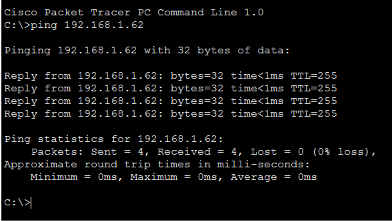

**PC1 to PC2, same VLAN across switches**

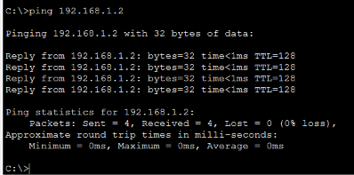

**Inter-VLAN, Network 1**

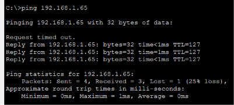

**Inter-VLAN, Network 2**

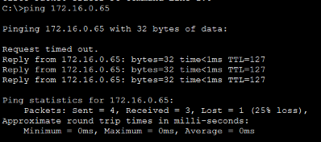

**Inter-VLAN, Network 3**

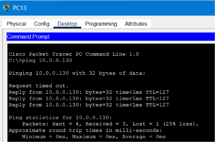

**PC13 to PC1**

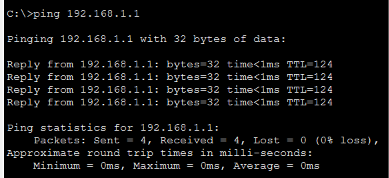

**PC1 to PC13**

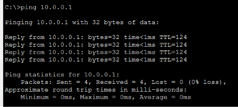

**PC1 to Network 2**

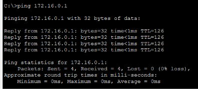

**PC13 to PC7**

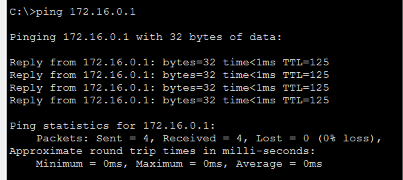

For the addressing plan, see [addressing-table.md](addressing-table.md). For VLAN details, see [vlan-table.md](vlan-table.md).
